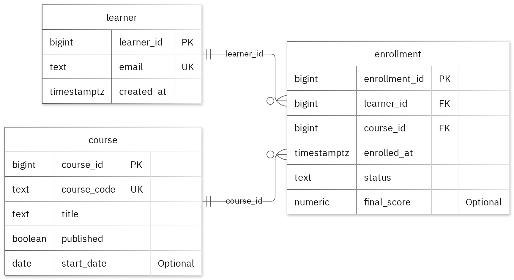

# MIT 8103 Advanced Database Systems

**Online Learning & LMS Platform** · Samuel Babalola · Student ID 301924257

## Case study

This database powers an online learning and LMS platform designed to seamlessly connect learners, instructors, and administrators within a digital classroom. At its core, the system brings together three essential pillars: the students pursuing new skills (Learners), the educational content (Courses), and the registration history that ties them together (Enrollments). By organizing this data, the platform smoothly manages daily campus operations, allowing teams to create and update learner profiles and course catalogs, register students while tracking their lesson progress and exam scores, and review deep analytical summaries of student participation across different subjects.

## Portfolio 1: Database Design and Modelling

The first portfolio structures the relational database design into three distinct tables, using primary keys to uniquely identify records, foreign keys to preserve relationship links, and check constraints to enforce business rules. To keep the data clean, enrollment statuses are strictly limited to 'enrolled', 'completed', or 'withdrawn'. The accompanying normalization examples map the progression of our sample data through 1NF, 2NF, and 3NF structures. Finally, the system's integrity was successfully validated when all 22 deliberately invalid insert attempts were rejected by the database without altering the valid sample rows.

Figure 1. Tables, keys and relationships. PK: primary key; FK: foreign key; UK: unique value.

<!-- PAGE BREAK -->

## Portfolio 2: Query Processing and Optimisation

Running three SQL queries against the sample data returned two joined rows, successfully identifying learner.one@example.test within the LMS-101 course. To test the index performance, we evaluated 25,000 separate lookup rows, which revealed a massive drop in median query time from 1.485 ms down to just 0.232 ms. While both phases returned identical data records, the execution plan confirmed that the system successfully utilized the new index. Please note that these specific timing results are unique to this exact query lookup and testing environment.

## Portfolio 3: Transactions and Concurrency

I used a temporary counter on enrollment to test COMMIT, ROLLBACK and READ COMMITTED isolation. The uncommitted update remained hidden from the other session, and ROLLBACK restored the earlier committed value. Without locking, two increments left the counter at 2. With SELECT FOR UPDATE, Session B waited for Session A and the final value was 3. The helper is confined to this exercise; the case's original business fields stay unchanged.

## Portfolio 4: NoSQL and Advanced Data Models

I used learning_events for the case's event documents. MongoDB inserted 4 sample events and returned the expected results for 4 queries. Validation rejected an invalid date type and a duplicate event ID. Embedded snapshots keep related details with an event, while the details field can differ by event type. These are fictional events; PostgreSQL continues to enforce its relational rules.

## Repository and evidence

https://github.com/Samkrisnet/Babalola_Samuel_301924257

The portfolio folders contain the SQL and JavaScript, explanations, query plans, result tables and screenshots.

<!-- PAGE BREAK -->

## Portfolio 5: Distributed and Cloud Database Exercise

I proposed three MongoDB replica members across separate failure zones. The discussion covers primary elections, majority acknowledgement, secondary lag and sharding trade-offs for learning_events. Replication supports availability, while backups address recovery. PostgreSQL needs its own availability plan. This is the permitted discussion option; no live replica set or failover test was deployed.

## Individual reflection

By keeping learners, courses, and enrollments in separate tables, I isolated their unique details to prevent redundant data repetition across related records. To maintain strict data integrity, check constraints restrict the enrollment status strictly to 'enrolled', 'completed', or 'withdrawn', while comprehensive constraint testing validates these fields alongside required values and relationship links. A key challenge highlighted during the two-session concurrency exercise was a race condition where both sessions could read the same initial value before either update committed; introducing row locking prior to reading successfully preserved both incremental updates. Finally, the index performance comparison underscores why analyzing the execution plan is just as critical as verifying the final output, proving that identical query results can demand vastly different amounts of database work.

## Project Timeline

This project was developed and refined over the past two weeks, with the final updates and completion work completed today. The repository reflects the final delivery state of the project, and the work was consolidated into the current version as part of the final review and submission process. The project timeline represents the full development period leading up to completion, rather than a day-by-day commit history. Final documentation and delivery were completed in the current stage to ensure the portfolio accurately reflects the finished work.

## AI-use declaration

To streamline the development of this database model, scripts, and documentation, I leveraged GitHub Copilot and an automated portfolio generator. The generator efficiently executed the PostgreSQL and MongoDB exercises, validated their outputs, and captured the resulting performance and imagery files. While these AI and automation tools significantly accelerated the technical pipeline, I maintain full responsibility for auditing, explaining, and validating all the submitted work to ensure absolute accuracy.

## References

- [PostgreSQL: constraints](https://www.postgresql.org/docs/17/ddl-constraints.html)
- [PostgreSQL: EXPLAIN](https://www.postgresql.org/docs/17/using-explain.html)
- [PostgreSQL: isolation](https://www.postgresql.org/docs/17/transaction-iso.html)
- [PostgreSQL: row locks](https://www.postgresql.org/docs/17/explicit-locking.html)
- [MongoDB: data modelling](https://www.mongodb.com/docs/manual/data-modeling/)
- [MongoDB: replication](https://www.mongodb.com/docs/manual/replication/)
- [MongoDB: sharding](https://www.mongodb.com/docs/manual/sharding/)
- [Mermaid: ER diagrams](https://mermaid.js.org/syntax/entityRelationshipDiagram.html)

